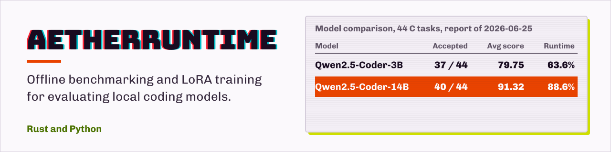

<p align="center">
  
</p>

# research-claw-code

[English](README.md) · **繁體中文**

## 快速展示

```bash
python local_ai/cli.py smoke
python local_ai/cli.py system
python local_ai/cli.py adapters
python local_ai/cli.py routing --benchmark c_exam_2025_strict_seeded
python local_ai/demo/demo_walkthrough.py
```

重要文件：

- `local_ai/docs/DEMO_WALKTHROUGH.md`
- `local_ai/docs/PORTFOLIO_SUMMARY.md`
- `docs/PROMPT_ARCHITECTURE.md`
- `docs/PROMPT_STATE_SUMMARY.md`
- `local_ai/demo/reports/demo_index.md`
- `local_ai/demo/reports/demo_summary.md`
- `local_ai/system/reports/architecture_map.md`

## 展示導覽

用 V8 展示平台介紹這個專案，不需要執行任何模型：

```bash
python local_ai/demo/build_demo_index.py
python local_ai/demo/generate_demo_summary.py
python local_ai/demo/demo_walkthrough.py
```

展示流程會依序呈現 smoke 驗證、adapter 治理、依任務的 routing、release 快照、benchmark 報告與架構圖。

## 目前狀態

- V1–V8 的基礎設施已完成，涵蓋到展示平台與 prompt 架構。
- 最新 release 快照：`local_ai_cli_v7`。
- Smoke test 狀態：PASS。
- `retry_geometry_v3_guarded` 保留為 `safe_no_change`。
- 沒有選定任何預設 adapter。
- 合成資料的 LoRA 訓練已凍結；產生的資料集維持隔離，只當作評測與壓力測試素材。

## 已知限制

- 沒有任何 adapter 被提升為預設。
- 即使參考解答都驗證過，合成的 SFT 候選資料仍造成退步。
- Routing 目前只規劃要選哪個 adapter，不會實際執行模型推論。
- 明確呼叫 benchmark 時，執行仍需要本機的模型／proxy 路徑。

## 系統元件

- **Benchmark 基礎設施**：以設定檔驅動的 benchmark profile，對程式題做編譯、執行、語意與關鍵字驗證。
- **Adapter 治理**：LoRA adapter 的提升政策、adapter registry、退步分析，以及 safe／no-change 追蹤。
- **模型治理**：替換模型的 benchmark、橫跨 strict 與 generated benchmark 的加權提升政策，以及核准模型 registry。
- **退步偵測**：由政策驅動的偵測器，比較不同時間的 benchmark 執行結果、自動找出參考執行，並產生受治理的判定（`pass`／`improvement`／`regression`／`manual_review`），作為提升的關卡。
- **持續 Benchmark 趨勢**：唯讀彙整執行歷史，追蹤每個模型的分數趨勢，並自動對最新一組執行跑退步偵測器（`python local_ai/cli.py trend`）。
- **治理可觀測性**：單一的跨層狀態檢視，列出 adapter、模型、資料集、退步、可靠度與 profile 中，哪些已提升／safe／被拒絕／等待審查（`python local_ai/cli.py governance`）。
- **評測可靠度**：唯讀稽核執行歷史中的可重現性標記與每題的確定性（偵測不穩定題目）（`python local_ai/cli.py reliability`）。
- **Prompt／Profile 治理**：檢查 prompt profile 引用的 prompt 檔確實存在且非空，標出非確定性的 temperature，並記錄核准 profile registry（`python local_ai/cli.py profiles`）。
- **Goldens 治理**：驗證並提升經人工確認的 golden 案例（把候選放進 `local_ai/goldens/candidates/`，經編譯／執行驗證，依來源分級）到核准 registry（`python local_ai/cli.py goldens`）。
- **Routing 治理**：稽核 routing 政策與規劃，確保 routing 只能選擇治理核准的 adapter（`python local_ai/cli.py route-audit`）。
- **部署就緒關卡**：單一的 ready／blocked 判定，彙整 smoke、設定、profile、routing、退步、可靠度、待審積壓與 goldens；只要有任何阻擋項失敗或從未執行，就擋下 release（`python local_ai/cli.py deploy`）。
- **匯入翻譯**：在兩個資料匯入點（題庫匯入與 ingest 訓練準備）可選擇啟用的中翻英題目翻譯，使用專用的本機模型，保留原文並產生 JSON＋MD 稽核報告（`corpus/import_exam.py` 與 `ingest/prepare_training.py` 的 `--translate`）。
- **題目 RAG 匯出**：匯入的題目（原本就是英文，或翻譯後）會自動寫成純 `.md` 檔放進 `local_ai/rag/docs/problems/` 並重建 RAG 索引，讓本機模型能用 `--rag` 檢索題目內容（用 `--no-rag-md` 關閉）。
- **重試迴圈**：失敗挖掘、精選修復目標、golden 範例，以及有防護的重試資料集。
- **資料集擴充**：隔離的產生任務素材、驗證報告與合成 benchmark 壓力測試。
- **Routing 層**：依任務選擇 adapter 的 routing，預設使用 base，只考慮狀態為核准的 adapter。
- **Release 快照系統**：里程碑快照與報告索引，讓專案狀態可以重現。
- **展示平台**：可直接放進作品集的展示索引、摘要與導覽。
- **Prompt 架構**：agent prompt 與防護狀態摘要，讓之後的自動化維持穩定。

## 模型治理

替換模型的決定和 adapter 提升、資料集提升走同一套治理紀律：先跑 benchmark，再由政策決定，沒有任何寫死的規則。

**1. Benchmark**：在穩定的 profile 上（一個 strict 考試 benchmark 與一個 generated 任務 benchmark）比較候選模型與 baseline：

```bash
python local_ai/model_eval/compare_models.py \
    --models qwen25_coder_3b qwen25_coder_14b
```

這會寫出 `local_ai/model_eval/reports/model_comparison.json`／`.md`。報告中的建議由提升政策產生，不是 `compare_models.py` 裡手寫的規則。

**2. 比較**：每個候選模型在每個 benchmark 上，量測 accepted、平均分數、編譯、執行與語意相對 baseline 的差值，另外用 `model_override_valid` 檢查實際提供服務的確實是指定的模型。

**3. 提升**：政策同時權衡兩個 benchmark：

```bash
python local_ai/model_eval/promote_model.py \
    --comparison local_ai/model_eval/reports/model_comparison.json
```

- `promotion_policy.py` 存放可調整的政策：`strict_weight`（0.6）、`generated_weight`（0.4）、`require_override_valid`，以及 `reject < candidate < safe < default` 的階梯。
- 判定：`reject`、`candidate`、`safe_no_change`、`promote_default`、`manual_review` 與 `invalid_model_override`。
- strict benchmark 退步、同時 generated benchmark 有明顯進步，屬於**衝突**，結果是 `manual_review`，絕不會自動「維持 baseline」。
- 若 `model_override_valid` 為 false，判定為 `invalid_model_override`，提升會被擋下。

報告寫在 `local_ai/model_eval/reports/model_promotion_report.json`／`.md`。

**4. 核准模型**：`local_ai/model_eval/models/approved_models.json` 依判定記錄每個評估過的候選模型；`default_model` 只會由乾淨的 `promote_default` 設定，也不會被其他操作順帶降級。

## 自動退步偵測

不重跑模型、不動評分，就能偵測兩次 benchmark 執行之間的退步。偵測器重用 `compare_runs.compare()`，套用可調整的退步政策（門檻是資料，不是程式碼），再產生受治理的判定。

```bash
# 比較兩次指定的執行
python local_ai/cli.py regression --base <prev_run_id> --new <run_id>

# 自動找出同一模型的前一次執行
python local_ai/cli.py regression --new <run_id>

# 不需要模型的判定自我測試（smoke test 也會跑）
python local_ai/cli.py regression --self-test
```

- 判定：`pass`、`improvement`、`regression`、`manual_review`（退步與進步訊號互相衝突）、`no_reference`（沒有可比較的對象）。
- `regression` 判定會以非零值結束，讓提升關卡與 CI 可以擋下。
- 訊號：accepted 差值、平均分數差值、編譯／執行通過率差值、新壞掉的題目，以及任何單題下降超過政策門檻。標準的可調整政策在 `local_ai/shared/regression_policy.py`（也可以傳 `--policy <file.json>`）。
- 報告：`local_ai/benchmark/reports/regression/regression_report.{json,md}`。

### 提升關卡上的退步防護

同一套標準政策接進 **adapter** 與 **模型** 的提升執行器，作為*單調的安全疊加層*：它只能**擋下**提升，永遠不會核准提升：

- Adapter（`sft/promote_adapter.py`）：`regression` 判定會把 `promote`／`safe_no_change` 降為 `reject`；有衝突的 `manual_review` 判定會降為 `ablation_only`。
- 模型（`model_eval/promote_model.py`）：任一 benchmark 出現 `regression` 或 `manual_review` 判定，就把 `promote_default` 降為 `manual_review`，並重新計算主要建議。
- 防護紀錄（`regression_guard`）會附在每份提升報告與 registry 條目上供稽核。以目前的資料，所有判定都沒有改變：防護只是多一層安全網與稽核軌跡。

## 快速 Smoke Test

commit 前先跑快速的基礎設施 smoke test：

```bash
python local_ai/system/smoke_test.py
```

Smoke test 會驗證設定檔、報告索引、adapter registry 摘要與 routing 規劃，不執行模型、不訓練 adapter、不呼叫 proxy，也不需要 CUDA／torch。

## 統一 CLI

常見工作流程以 `local_ai/cli.py` 作為主要的開發入口：

```bash
python local_ai/cli.py smoke
python local_ai/cli.py validate-config
python local_ai/cli.py adapters
python local_ai/cli.py routing --benchmark c_exam_2025_strict_seeded
python local_ai/cli.py regression --new <run_id>
python local_ai/cli.py trend
python local_ai/cli.py reliability
python local_ai/cli.py profiles
python local_ai/cli.py goldens
python local_ai/cli.py route-audit
python local_ai/cli.py deploy
python local_ai/cli.py governance
python local_ai/cli.py system
python local_ai/cli.py snapshot --name local_ai_routing_v4
```

任何子指令加上 `--dry-run`，只會印出底層的腳本指令而不執行。CLI 不包含訓練指令；benchmark 只能透過明確的 `benchmark` 子指令執行。

## Prompt 架構

Agent 與自動化的 prompt 應該使用目前的治理狀態：

- `docs/PROMPT_ARCHITECTURE.md`
- `docs/PROMPT_STATE_SUMMARY.md`

這些 prompt 把專案定義為以本機為主的 AI 實驗基礎設施，而不是聊天機器人產品或正式環境的推論服務。它們記錄目前啟用的防護、凍結的路線、穩定的 adapter、已知限制，以及之後偏好的方向。

核心防護：

- 不要執行沒有上限的合成資料 LoRA 訓練。
- 不要自動提升 adapter。
- 不要順手修改 benchmark 評分。
- 沒有驗證與更新報告，不要改 routing 政策。
- 不要把 benchmark 的失敗輸出當作訓練目標。
- 不要把沒驗證過的產生資料集併入正式 SFT 資料。

這個專案是以本機為主的程式碼 LLM 評測與 LoRA 實驗框架，重點在經編譯／執行驗證的 benchmark、失敗挖掘、重試訓練，以及離線程式碼模型的 adapter 治理。

## 使用手冊

`research-claw-code` 是 `claw` CLI 的研究與本地化專案，主要有兩條使用路線：
**離線 bundle**（在有網路的機器打包 `claw + Ollama + 模型`，搬到離線環境直接用）
與 **Rust CLI 開發**（在 `rust/` workspace 內開發 `claw` 本體）。

所有使用教學已整理成獨立的使用手冊：**[`docs/USER_MANUAL.md`](./docs/USER_MANUAL.md)**，
內容包含：

- 離線部署：Level 1 Windows air-gap 目標、bundle 準備/複製/啟動、USB workflow、清理
- 日常使用：離線模式行為、多行輸入、硬體與模型推薦、常用環境變數、除錯與 smoke test
- RAG 與題目資料：本地文件庫、題目中翻英匯入、題目 RAG `.md` 檔
- 評測：C Exam Offline Eval Pack、benchmark 實驗流程
- Rust CLI 開發入口與注意事項

## 專案結構

```text
.
├── local_ai/   # 離線 bundle、proxy、啟動與清理腳本
├── rust/       # claw CLI Rust workspace
├── src/        # 早期 Python port / 研究與對照工具
├── tests/      # Python 端測試與加固驗證
└── docs/       # 使用手冊與補充研究文件
```

## 文件導覽

- [`docs/USER_MANUAL.md`](./docs/USER_MANUAL.md)：完整使用手冊（部署、日常使用、題目匯入、評測）
- [`usage.txt`](./usage.txt)：最短版離線使用說明
- [`USAGE.md`](./USAGE.md)：`claw` CLI 與 Rust workspace 用法
- [`local_ai/README.md`](./local_ai/README.md)：離線 bundle 細節、架構與疑難排解
- [`rust/README.md`](./rust/README.md)：Rust workspace、crate 分工與開發入口
